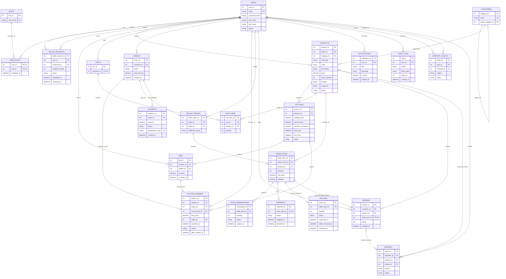

# MarketLink – ER Diagram and Relational Data Model

This is a proposed logical model for the required MarketLink marketplace workflows. It complements the database table and constraint documentation in [PR #20](https://github.com/VlahoErceg/FESB-MarketLink/pull/20); it does not modify that document or represent a database that has already been created.

The model uses one category per product and requires an image URL, as decided for this ER model. The database-level columns and constraints should be finalized together with the detailed schema.

## ER Diagram

## Relational Model

| Relation | Purpose and key relationships |
|---|---|
| `users` | User accounts. New accounts receive the buyer role through `user_roles`. |
| `roles`, `user_roles` | Role catalog and user-to-role assignments, including buyer, seller, and administrator. |
| `seller_requests` | Seller applications, decision status, administrator reviewer, and request number. The maximum of three requests per user must be enforced transactionally by the application or database. |
| `categories` | Product categories, optionally arranged in a parent-child hierarchy. |
| `products` | Seller-owned catalog items. Each product references exactly one category and stores its sale type, stock, location, required image URL, and active/archive state. For `FIXED_PRICE`, the existing `price` field is used; for `AUCTION`, the auction record stores the bidding prices. |
| `auctions` | Auction schedules and current state for products sold by auction. Each auction sells one product unit. A product can have auction history, but no more than one scheduled, active, or awaiting a winner's purchase at a time. |
| `bids` | Accepted bid history for an auction. Each bid belongs to one bidder and one auction. |
| `carts`, `cart_items` | One cart per buyer and its product quantities. |
| `orders` | Buyer checkout and order-level amount/status. |
| `auction_winners` | Sequential purchase offers to the highest remaining valid bidder. Each attempt references the selected bid and its order; status and offer expiry track whether it is awaiting checkout, awaiting payment, paid, payment-rejected, payment-timed-out, or expired. |
| `seller_orders` | Groups an order's items by seller so each seller can manage only their fulfillment portion. A unique constraint on `(order_id, seller_id)` identifies each seller portion. |
| `order_items` | Purchased product and quantity snapshots, including unit price and subtotal at checkout. |
| `payments` | Simulated payment attempts and outcomes. An idempotency key supports safe processing of repeated payment events. |
| `stock_reservations` | Inventory reserved for order items while payment is pending, including expiry and release state. |
| `shipments` | Delivery status for an order item. Tracking through a real courier is outside this model. |
| `returns` | Return request and lifecycle for an order item, including when the seller receives it and when the simulated refund is issued. |
| `reviews` | Buyer review tied to a delivered order item; one review per order item. |
| `notifications` | Persisted in-app notifications received by users, including auction outbid alerts. |
| `audit_logs`, `support_tickets`, `reports` | Supporting administrative and support relations included in the companion database proposal; these are not required for the core marketplace ER model. |

## Relationship and Integrity Rules

- One user can have multiple roles and multiple seller requests. A seller request belongs to one applicant and may be reviewed by one administrator.
- A user's seller role is granted only after an administrator approves a request. Pending applicants remain buyers. The request limit is three per user.
- Each product belongs to one seller and one category. Sellers can manage only their own products; administrator permissions are enforced by the application.
- A product uses either `FIXED_PRICE` or `AUCTION` sale type. Fixed-price purchases continue to use the existing cart and checkout flow unchanged; auction purchases use the same order and payment system after a bidder is selected.
- For `FIXED_PRICE`, `products.price` remains the sale price. For `AUCTION`, `auctions.starting_price`, `current_price`, and `minimum_increment` govern bids; fixed-price behavior is otherwise unchanged.
- Each auction is for one unit of the product. A product can have multiple auctions over time, but at most one may be `SCHEDULED` or `ACTIVE` at a time, and no new sale/auction may begin while a winner has an unexpired purchase offer. Auction status is `SCHEDULED`, `ACTIVE`, `ENDED`, or `CANCELLED`.
- A user cannot bid on their own product. A bid is accepted only while its auction is `ACTIVE`, within the start/end time, and only if its amount is at least the current highest bid plus the auction's minimum increment (or at least the starting price when there are no bids).
- Concurrent bids must be serialized or otherwise handled atomically so every accepted bid satisfies the minimum-increment rule and the current price cannot move backwards.
- Whenever a new valid bid raises the current price, create an in-app notification in `notifications` for every earlier bidder whose highest bid in that auction is now below the new highest bid. Do not notify the user who placed the new bid. Notifications are stored for viewing in the application; email and push delivery are not included.
- At auction end, the highest valid bid is offered the purchase first. The bidder has 24 hours from `awarded_at` to accept the offer and start checkout through the existing order/payment flow. The auction product is not available for another sale while a purchase offer is pending.
- Once the winner starts payment, the existing 15-minute payment/reservation timeout applies. If payment is rejected or times out, that offer ends immediately and the next-highest valid bidder is offered the purchase with a new 24-hour deadline. If the winner does not start checkout within 24 hours, the offer expires and the next-highest valid bidder is offered the purchase.
- Each purchase offer is recorded in `auction_winners` with its selected bid, buyer, final price, associated order, status, and `offer_expires_at`. Offer statuses are `OFFER_PENDING`, `PAYMENT_PENDING`, `PAID`, `PAYMENT_REJECTED`, `PAYMENT_TIMED_OUT`, and `EXPIRED`. `OFFER_PENDING` lasts up to 24 hours; `PAYMENT_PENDING` begins when checkout/payment starts and follows the existing 15-minute timeout. Each failed order attempt is cancelled before advancing.
- Only one offer per auction may be pending at a time, and no more than one offer may become the paid final winner. If all valid bidders fail to pay or let their offer expire, the auction ends unsold.
- An auction that ends without bids is marked `ENDED` with no winner or order; the seller may create a new auction for the product.
- Each buyer has at most one cart. A cart contains cart items, and the same product should appear at most once per cart.
- An order belongs to one buyer and is split into one or more seller orders. Each seller order belongs to one seller and contains one or more order items.
- Order items preserve the purchased product, quantity, and confirmed unit price so later product edits do not change historical orders.
- Inventory reservation and payment result processing must be atomic and idempotent. A repeated request or payment event must not duplicate an order, refund, or inventory adjustment.
- A review is allowed only for a delivered order item and at most one review is allowed per order item.
- A return request is tied to an order item, may be submitted within seven days after delivery, and is refunded after the seller receives the returned product.
- Price/quantity checks, allowed status transitions, role permissions, the 24-hour cancellation window, reservation expiry, and one-time stock/refund effects require application validation and transactional handling in addition to relational constraints.

## Scope Notes

- This file is the ER diagram and logical relationship model for issue #8. It intentionally does not repeat the full column types, constraint definitions, or referential actions documented for issue #9.
- `product_categories` from the companion proposal is replaced here by `products.category_id`, matching the agreed one-category-per-product model and the existing API's single `categoryId`.
- Auction-specific tables extend the model alongside fixed-price sales; they do not replace the existing fixed-price cart/order/payment workflow.
- The auction lifecycle and outcomes for seller-initiated cancellation of an already scheduled or active auction must be agreed before implementation.
- Recommendations and sales dashboards are derived from catalog and order data; separate persistence tables are not required by the current requirements.
- The return shipping cost and whether returned stock becomes available for sale remain undecided.
