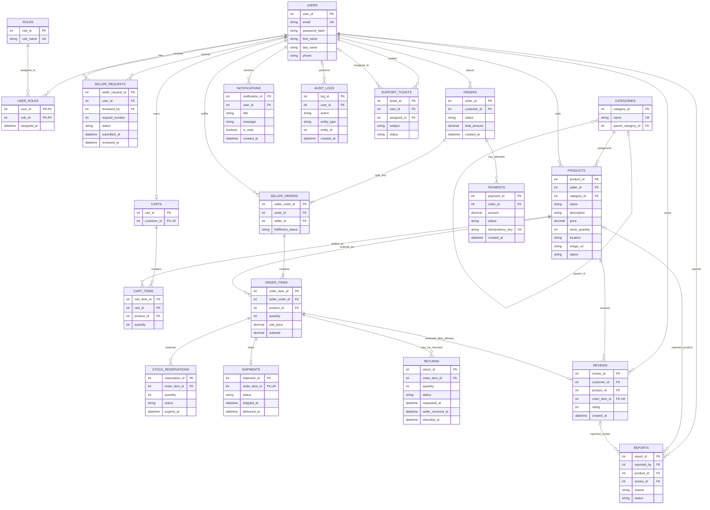

# MarketLink – ER Diagram and Relational Data Model

This is a proposed logical model for the required MarketLink marketplace workflows. It complements the database table and constraint documentation in [PR #20](https://github.com/VlahoErceg/FESB-MarketLink/pull/20); it does not modify that document or represent a database that has already been created.

The model uses one category per product and requires an image URL, as decided for this ER model. The database-level columns and constraints should be finalized together with the detailed schema.

## ER Diagram

## Relational Model

| Relation | Purpose and key relationships |
|---|---|
| `users` | User accounts. New accounts receive the buyer role through `user_roles`. |
| `roles`, `user_roles` | Role catalog and user-to-role assignments, including buyer, seller, and administrator. |
| `seller_requests` | Seller applications, decision status, administrator reviewer, and request number. The maximum of three requests per user must be enforced transactionally by the application or database. |
| `categories` | Product categories, optionally arranged in a parent-child hierarchy. |
| `products` | Seller-owned catalog items. Each product references exactly one category and stores its price, stock, location, required image URL, and active/archive state. |
| `carts`, `cart_items` | One cart per buyer and its product quantities. |
| `orders` | Buyer checkout and order-level amount/status. |
| `seller_orders` | Groups an order's items by seller so each seller can manage only their fulfillment portion. A unique constraint on `(order_id, seller_id)` identifies each seller portion. |
| `order_items` | Purchased product and quantity snapshots, including unit price and subtotal at checkout. |
| `payments` | Simulated payment attempts and outcomes. An idempotency key supports safe processing of repeated payment events. |
| `stock_reservations` | Inventory reserved for order items while payment is pending, including expiry and release state. |
| `shipments` | Delivery status for an order item. Tracking through a real courier is outside this model. |
| `returns` | Return request and lifecycle for an order item, including when the seller receives it and when the simulated refund is issued. |
| `reviews` | Buyer review tied to a delivered order item; one review per order item. |
| `notifications` | Persisted notifications received by users. |
| `audit_logs`, `support_tickets`, `reports` | Supporting administrative and support relations included in the companion database proposal; these are not required for the core marketplace ER model. |

## Relationship and Integrity Rules

- One user can have multiple roles and multiple seller requests. A seller request belongs to one applicant and may be reviewed by one administrator.
- A user's seller role is granted only after an administrator approves a request. Pending applicants remain buyers. The request limit is three per user.
- Each product belongs to one seller and one category. Sellers can manage only their own products; administrator permissions are enforced by the application.
- Each buyer has at most one cart. A cart contains cart items, and the same product should appear at most once per cart.
- An order belongs to one buyer and is split into one or more seller orders. Each seller order belongs to one seller and contains one or more order items.
- Order items preserve the purchased product, quantity, and confirmed unit price so later product edits do not change historical orders.
- Inventory reservation and payment result processing must be atomic and idempotent. A repeated request or payment event must not duplicate an order, refund, or inventory adjustment.
- A review is allowed only for a delivered order item and at most one review is allowed per order item.
- A return request is tied to an order item, may be submitted within seven days after delivery, and is refunded after the seller receives the returned product.
- Price/quantity checks, allowed status transitions, role permissions, the 24-hour cancellation window, reservation expiry, and one-time stock/refund effects require application validation and transactional handling in addition to relational constraints.

## Scope Notes

- This file is the ER diagram and logical relationship model for issue #8. It intentionally does not repeat the full column types, constraint definitions, or referential actions documented for issue #9.
- `product_categories` from the companion proposal is replaced here by `products.category_id`, matching the agreed one-category-per-product model and the existing API's single `categoryId`.
- Recommendations and sales dashboards are derived from catalog and order data; separate persistence tables are not required by the current requirements.
- The return shipping cost and whether returned stock becomes available for sale remain undecided.
